<p align="center">
  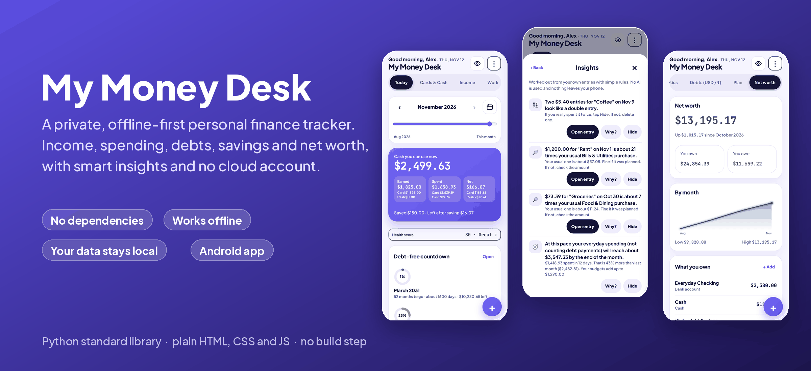
</p>

<p align="center">
  <a href="https://github.com/bvskrishna3137/my-money-desk/actions/workflows/ci.yml"></a>
  
  
  
  <a href="LICENSE"></a>
</p>

# My Money Desk

A personal finance tracker I designed and built for myself, and use every day. It tracks income, spending, cards and cash, debts, savings and net worth, and keeps **all data on my own device**: no cloud account, no bank connection, no tracking.

It is one HTML file plus a small Python server, with **no framework, no build step and no dependencies**. The interesting part is not any single screen. It is the product thinking underneath: a daily-use tool that explains itself, protects its data, and stays simple by making every extra feature optional.

## Highlights

- **Insights without AI.** Plain rules and math find probable double entries, unusually large purchases and where the month will end at the current pace. Every note has a **Why?** that shows the exact numbers behind it.
- **Health score (0 to 100)** from savings rate, debt load, budget and emergency cushion, with a reason for every change.
- **Built to never lose data.** Atomic saves, a revision counter that stops stale copies overwriting new work, 30-minute restore points, and a guard that keeps a safe copy before any unusually large drop in entries.
- **Debts, in two currencies.** Debt-free date, avalanche or snowball payoff planning, 0% promo deadlines, and an overseas (₹) account with a remittance-rate helper.
- **Simple by choice.** 56 optional features, each with its own on/off switch. Turn one off and it disappears from every screen; turn it on again and your data is still there.
- **27 looks**, from a calm classic to dot-matrix, plus a privacy mode that blurs amounts and an optional PIN lock.
- **Works offline** on a phone or computer, and also ships as an Android app.

## Screenshots

All screenshots use made-up sample data ([`money-data.sample.json`](money-data.sample.json)).

<table>
  <tr>
    <td align="center">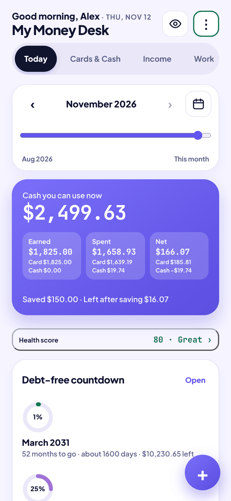<br><sub><b>Today</b><br>cash you can use, month at a glance</sub></td>
    <td align="center">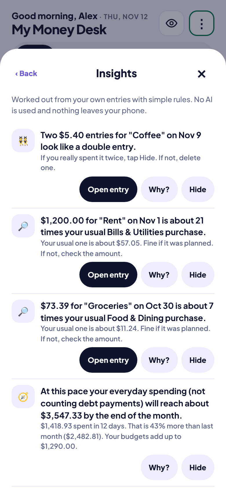<br><sub><b>Insights</b><br>plain-rule notes with a "Why?"</sub></td>
    <td align="center">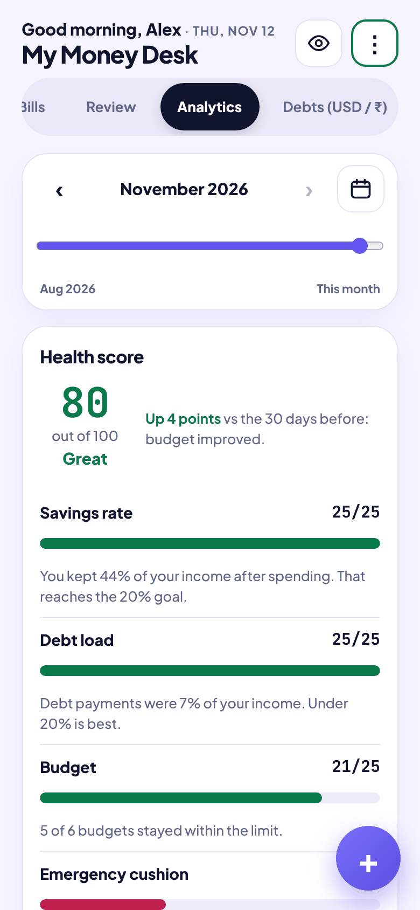<br><sub><b>Health score</b><br>what moved it and why</sub></td>
    <td align="center">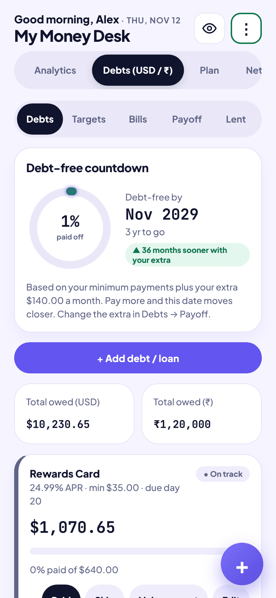<br><sub><b>Debts</b><br>debt-free date, USD and ₹</sub></td>
  </tr>
  <tr>
    <td align="center">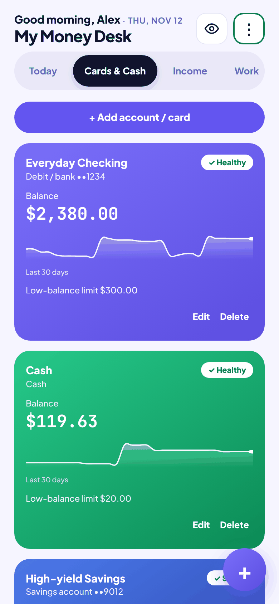<br><sub><b>Cards &amp; Cash</b><br>30-day trend per account</sub></td>
    <td align="center">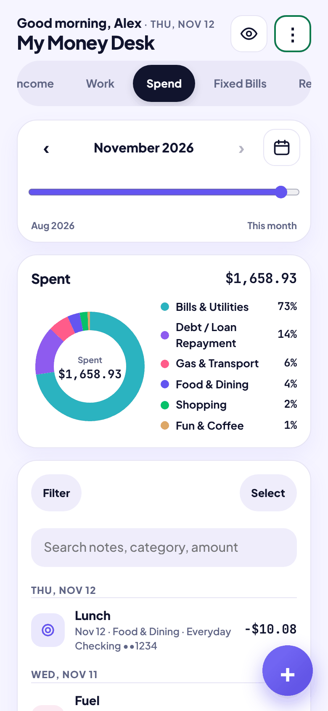<br><sub><b>Spend</b><br>categories, search, bulk edit</sub></td>
    <td align="center">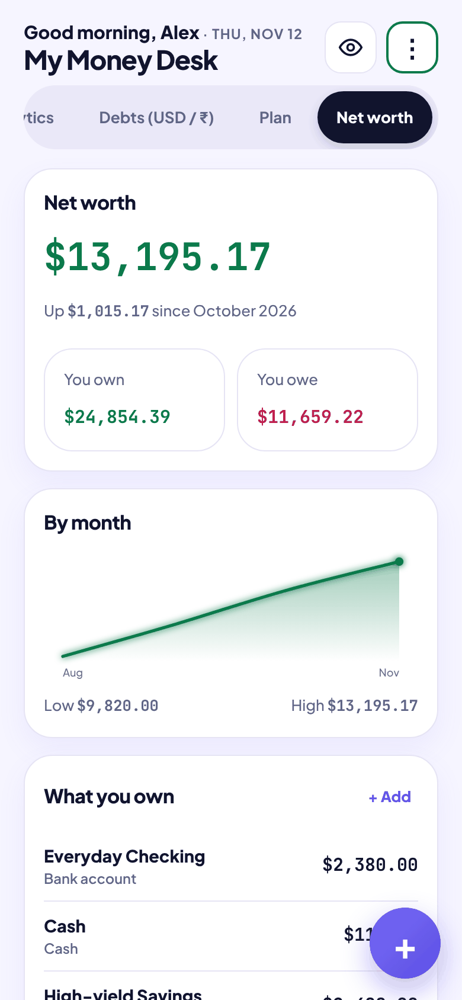<br><sub><b>Net worth</b><br>own minus owe, by month</sub></td>
    <td align="center">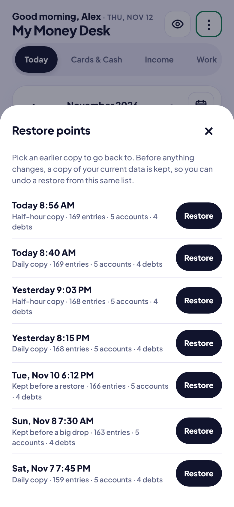<br><sub><b>Restore points</b><br>undo almost anything</sub></td>
  </tr>
</table>

<p align="center">
  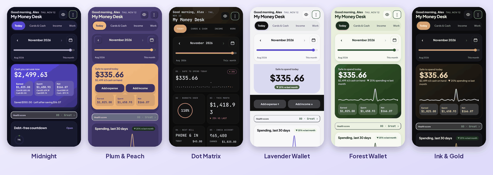<br>
  <sub>27 looks: 15 classic themes and 12 layout styles. The data is identical in every one.</sub>
</p>

A screen-by-screen tour is in the **[feature guide](docs/FEATURES.md)**.

## Try it in a minute

You need Python 3.10 or newer. Nothing else is installed.

```bash
git clone https://github.com/bvskrishna3137/my-money-desk.git
cd my-money-desk

# optional: start with the made-up sample data instead of an empty app
cp money-data.sample.json money-data.json        # Windows: copy money-data.sample.json money-data.json

python3 server.py                                # Windows: python server.py
```

Open <http://127.0.0.1:8080>. The sample data covers August to November 2026, so use the month slider at the top to move around.

Options: `python3 server.py --port 9000 --data-dir ~/my-money-data` keeps the data file somewhere else.

On Android I run the server in [Termux](https://termux.dev) and add the page to the home screen from Chrome; `start-money-desk.sh` and `update.sh` are small helpers for that.

## How it works

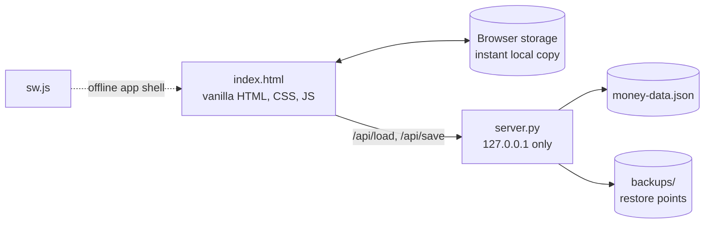

- **Front end:** one `index.html`, about 4,700 lines of vanilla JavaScript. No framework, no build step.
- **Server:** `server.py`, about 330 lines, Python standard library only. It serves the app and saves one JSON file.
- **Offline first:** every change is saved to the browser immediately, then to the file. If the server is off, the app keeps working and says so.
- **Android:** the same `index.html` runs in a thin wrapper that applies the same save rules on the phone itself.

The full design, including the save sequence, restore-point rules and data model, is in [docs/ARCHITECTURE.md](docs/ARCHITECTURE.md).

### Engineering notes

- Saves are **atomic**: temp file, `fsync`, then replace. A crash mid-save leaves the old file intact.
- A **revision counter** on every save returns `409` to a stale copy of the app instead of letting it overwrite newer data; the app then merges both sides (every entry kept, deletions remembered, newer edit wins).
- The server listens on `127.0.0.1` only, rejects an unexpected `Host` or `Origin`, serves a fixed list of app files, and refuses path tricks such as `?f=../money-data.json`.
- A service worker keeps the app files cached so the page opens even with no network.
- Found and fixed while preparing this repo: the app registered a service worker whose file was missing (a 404 on every load; `sw.js` is now included and offline loading was tested), and a keep-alive bug where a rejected POST left its body to be misread as the next request (now covered by a test).

## Tests

```bash
python3 -m unittest discover -s tests -v     # 18 tests, about a third of a second
python3 tools/check_js.py                    # syntax-checks all JavaScript (needs Node.js)
```

The tests cover save and load, conflicts, every restore-point rule, path traversal, host and origin checks, and **repo hygiene**: a test fails if a signing key, API key or real data file is ever committed. GitHub Actions runs everything on Python 3.10, 3.12 and 3.13.

## Decisions I made

The product choices matter as much as the code. These are the ones I would explain in an interview.

| Decision | Why |
|---|---|
| Manual entry, no bank connection | Privacy first. No third party ever sees my accounts, and entering things daily keeps me aware of my spending. |
| Insights from plain rules and math, not an LLM | They are explainable (every note has a **Why?**), free, instant and work offline. |
| An "Ask AI" button that only **copies** a summary | I can get advice from any assistant I choose without giving the app an API key or sending data anywhere on its own. The summary contains no card numbers or passwords. |
| 56 on/off feature switches | Power without clutter. A feature I do not need disappears from every screen; my data stays. |
| Restore points and a "big drop" guard | A finance tracker is only useful if it can be trusted. Most data loss is a mistake (a bad import, a mass delete), so the app keeps a copy first. |
| One screen per question | "Can I afford this?", "Where did it go?", "When am I debt-free?" each have one obvious place. |
| Animations only when a screen opens | No continuous animation, so it does not drain the phone battery. |

## Android app

The same design is also packaged as an Android app with its own reminders (bills, card due dates, budget warnings), receipt photos, a monthly PDF report, home-screen widgets and optional automatic backup to my own Google Drive. Its source lives in a separate private repository.

## Project layout

```
my-money-desk/
├── index.html               the whole app
├── server.py                local save server (standard library only)
├── sw.js                    offline app shell
├── native.js                Android layer (does nothing in a browser)
├── manifest.json, icon*     install-to-home-screen files
├── money-data.sample.json   made-up demo data
├── tests/                   server tests and repo-hygiene checks
├── tools/                   sample-data generator, screenshot builder, JS check
├── docs/                    feature guide, architecture, screenshots
└── .github/workflows/       CI
```

## Privacy

All data stays on the device. There are no accounts, no analytics and no bank connection. The browser makes one outside request, for the Google font; if it is unavailable the app falls back to a system font. In the Android app, the optional Drive backup sends data only to my own Google account. `money-data.json`, its backups and the `backups/` folder are listed in `.gitignore`, and a test fails if one is committed.

## Built with

Designed, tested and directed by me, and built with help from AI tools (Claude and Gemini). I made the product decisions: what to build, what to leave out, and how it should behave. I verified the result by using it daily, and the tests, checks and screenshots in this repo are reproducible with the scripts in `tools/`.

## License

MIT. See [LICENSE](LICENSE).

---

<sub>Built by Venkata Sai Krishna Baggu · [github.com/bvskrishna3137](https://github.com/bvskrishna3137)</sub>
