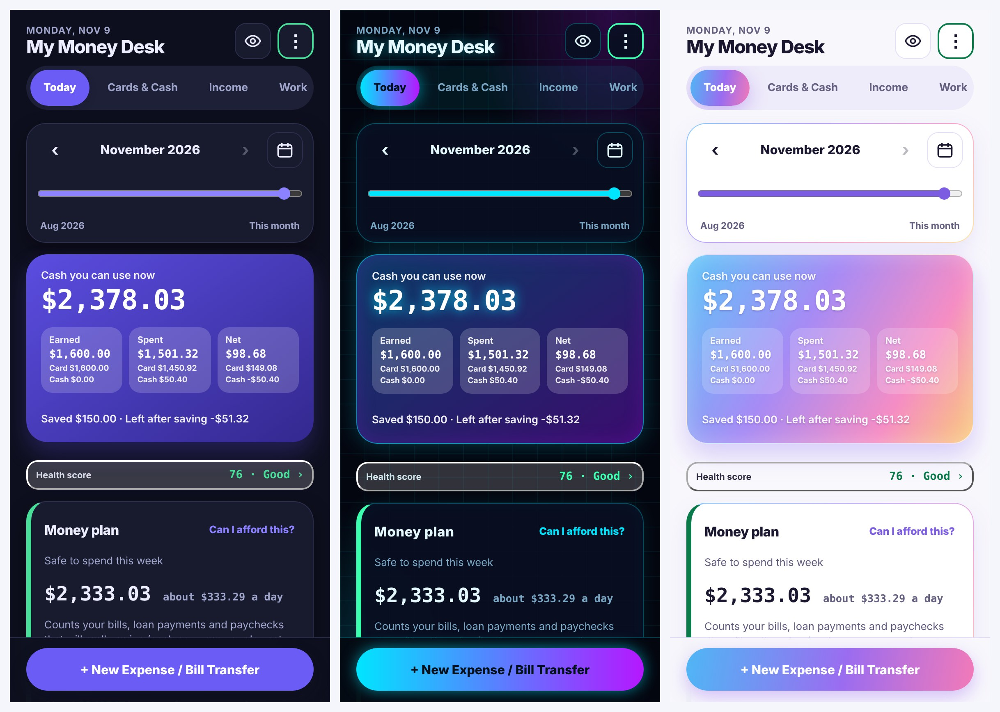
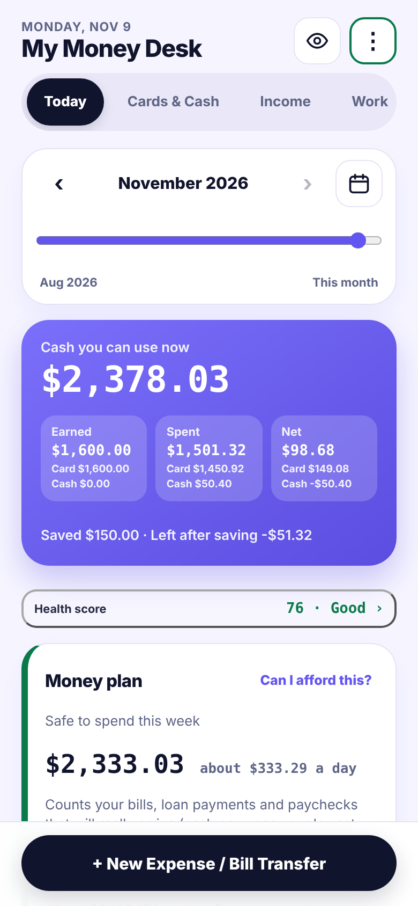
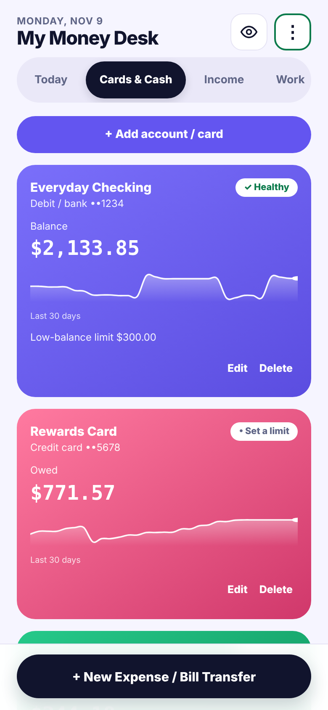
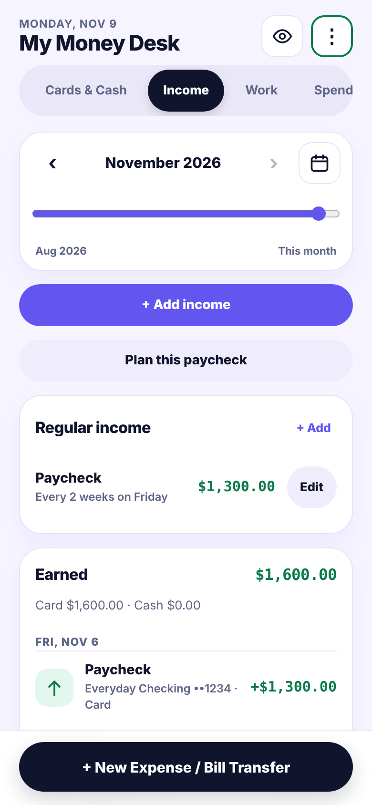
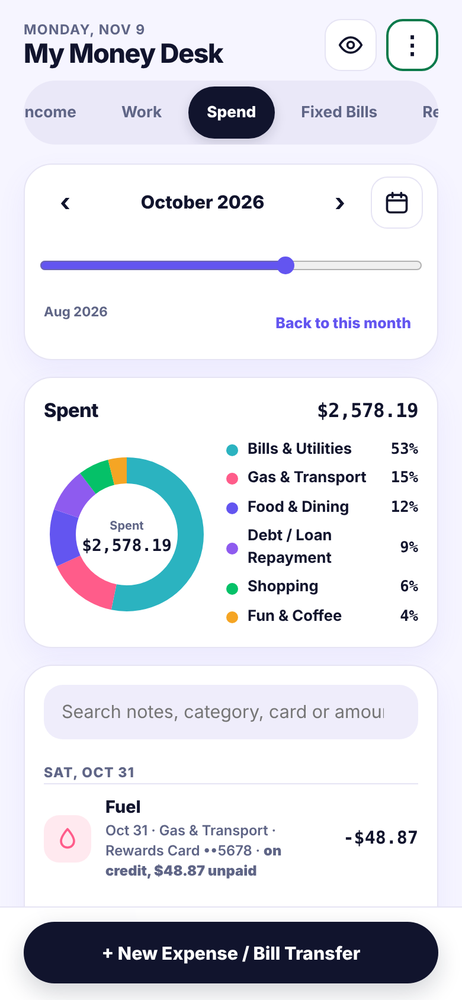
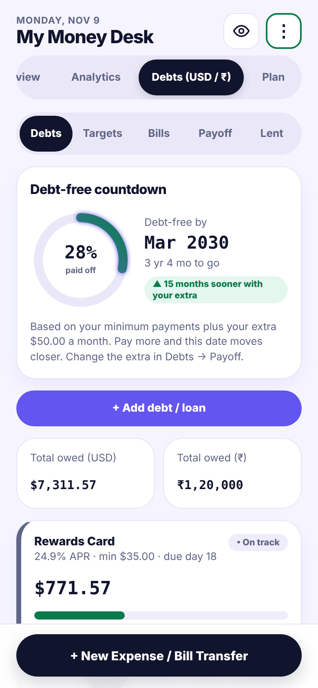
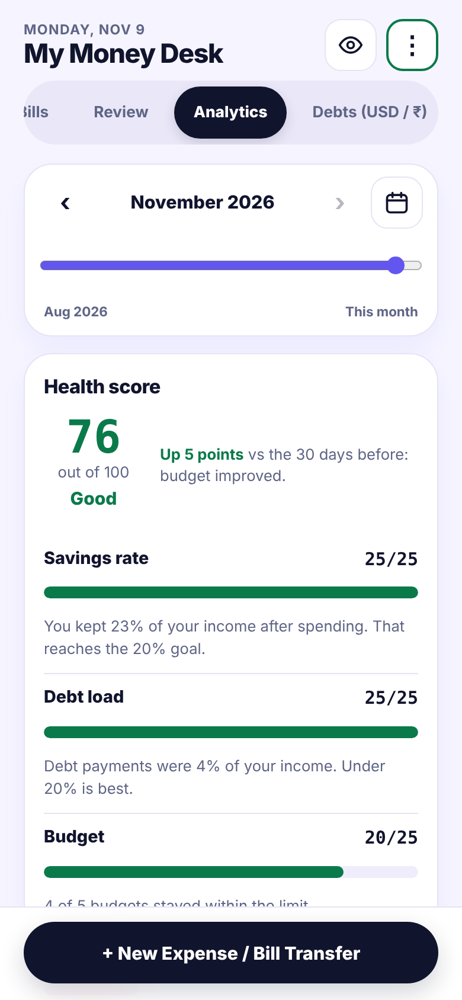

# My Money Desk

A personal finance tracker I designed and built as a web app. It tracks income, expenses, cards and cash, debts, and savings, and keeps every bit of data on my own device. No cloud account, no bank connection, no third-party scripts.



## Screenshots
| Today | Cards & Cash | Income |
|---|---|---|
|  |  |  |

| Spend | Debts | Analytics |
|---|---|---|
|  |  |  |

*All screenshots use made-up sample data from [`money-data.sample.json`](money-data.sample.json).*

## Why I built it
I wanted one simple place to log money every day, covering several accounts, cash, debts and savings, without giving a bank app access to my data. I built it around how I actually use money, then kept refining it through daily use.

## Features
- **Today** dashboard: cash you can use now, earned / spent / net for the month, and a "safe to spend this week" estimate
- **Cards & Cash**: debit, credit card, cash, savings and a second-currency (₹) account, each with a 30-day balance trend and low-balance warnings
- **Income**: one-off and recurring paychecks, plus a "plan this paycheck" helper
- **Work**: log hours for hourly or cash work and mark them as paid
- **Spend**: category breakdown, search by note, category, card or amount, split payments
- **Fixed Bills** and **Debts**: due dates, reminders, debt-free countdown, and avalanche / snowball payoff planning
- **Analytics**: a 0-100 financial health score with reasons for each change
- **Plan**: savings goals, an emergency fund calculator and quick-add shortcuts
- **15 color themes**, a privacy mode that blurs amounts, and an optional PIN lock
- **Backups**: daily backups, 30-minute restore points, and a guard that saves a copy before an unusually large drop in entries
- **Ask AI**: copies a monthly summary (no card numbers or passwords) so I can paste it into any AI assistant for advice

## How it works
- **Front end:** a single `index.html` with plain HTML, CSS and JavaScript. No framework and no build step.
- **Local server:** `server.py`, about 180 lines of Python using only the standard library. It serves the app and saves data to one JSON file.
- **Data:** stays in `money-data.json` next to the app, so it works offline and never leaves the device.
- **Optional reminders:** `reminders.py` can send phone notifications for due bills when run in Termux with the Termux:API add-on.

### Engineering notes
- The server listens on `127.0.0.1` only and rejects requests with an unexpected `Host` or `Origin`.
- Saves are atomic (write to a temp file, `fsync`, then replace), and the previous file is kept as `.bak`.
- A revision counter on each save stops an older copy of the app from overwriting newer data.
- The server refuses to serve its own source files, the data file and the backups folder.

## Run it yourself
You need Python 3.

```bash
git clone https://github.com/bvskrishna3137/my-money-desk.git
cd my-money-desk

# optional: start with the sample data instead of an empty app
cp money-data.sample.json money-data.json

python3 server.py
```
Then open <http://127.0.0.1:8080>.

The sample data covers August to November 2026, so use the month arrows at the top of each screen to move around. On Android I run it in [Termux](https://termux.dev) and install the page to my home screen from Chrome.

## Privacy
All data stays on the device. There are no accounts, no analytics and no network calls apart from loading the Google font. `money-data.json`, its backups and the `backups/` folder are listed in `.gitignore` so they can never be committed by accident.

## Built with
Designed, tested and directed by me, and built with help from AI tools (Claude and Gemini). I made the product decisions: what to build, what to leave out, and how it should behave.

## License
MIT. See [LICENSE](LICENSE).
