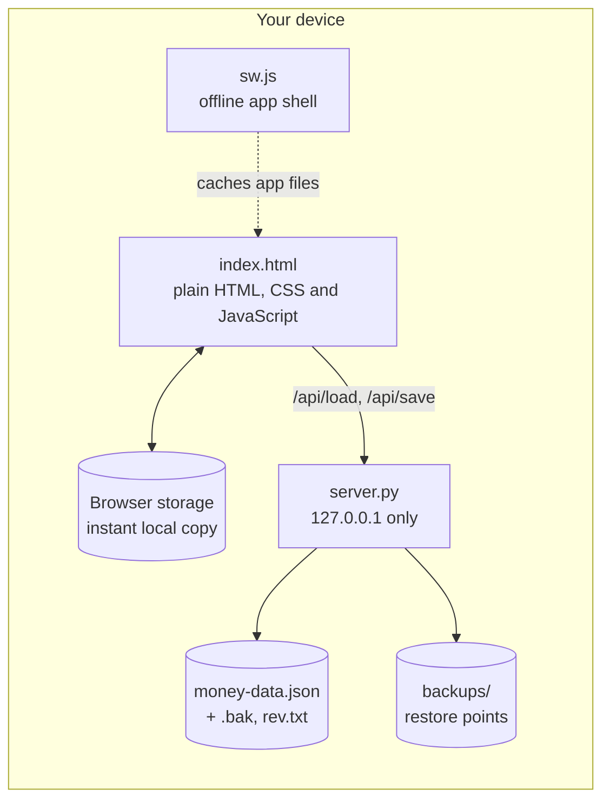
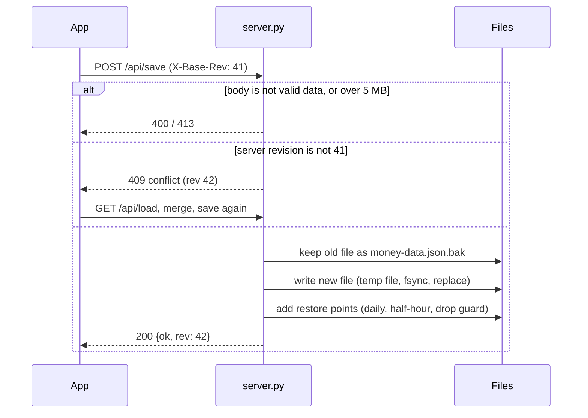

# Architecture

My Money Desk is deliberately small: one HTML file, one Python file, one JSON data file. This page explains how the pieces fit and why the safety features exist.

## Overview

- **Front end.** `index.html` holds the whole app: markup, styles and about 4,700 lines of vanilla JavaScript. There is no framework and no build step. State lives in one object (`app.data`) made of lists (expenses, income, cards, debts, bills, goals and so on).
- **Local server.** `server.py` uses only the Python standard library. It serves the app and saves the data file. It listens on `127.0.0.1` only.
- **Offline.** Every change is written to browser storage first and then sent to the server after a short pause. If the server is not running, the app keeps working from browser storage and shows "Saved in browser only". `sw.js` caches the app files so the page itself also opens with no network.
- **Android.** The same `index.html` runs inside a thin Android wrapper. `native.js` replaces the four server calls with code that follows the same rules and keeps the files in the app's private storage. In a normal browser `native.js` does nothing. The Android project itself is kept in a separate private repository.

## The four API calls

| Call | Purpose |
|---|---|
| `GET /api/load` | The saved data, with an `X-Rev` header (the save counter) |
| `POST /api/save` | Save the data (rules below) |
| `GET /api/backups` | List restore points |
| `GET /api/backup?f=NAME` | Fetch one restore point |

## How a save works

Why each rule exists:

- **Revision counter (`X-Base-Rev` / 409).** If the app is open on two devices, or an old browser tab wakes up with stale data, its save is refused instead of silently overwriting newer work. The app then loads the server copy and merges: every entry from both sides is kept, deletions are remembered for 400 days, and the newer edit of an entry wins.
- **Atomic writes.** The new file is written to a temporary file, flushed to disk with `fsync`, then swapped in with `os.replace`. A crash or power loss mid-save leaves the old, complete file in place.
- **`money-data.json.bak`.** The previous version is always kept next to the current one.
- **Validation.** The body must be a JSON object containing the lists the app needs, and at most 5 MB.

## Restore points

| Kind | When it is made | Kept |
|---|---|---|
| Daily copy | On a save, one per calendar day (overwritten through the day) | last 14 |
| Half-hour copy | On a save, when the newest one is 30 minutes old or more | last 6 |
| Kept before a big drop | When a save has at least 10 fewer entries **and** under 60% of the previous count (a likely accident, like a bad import or a mass delete) | last 10 |
| Kept before a restore | Right before you restore an older copy, so the restore can be undone | last 5 |

The "big drop" copy is the one that matters most: it is saved **before** the smaller data is written, and the daily copy is skipped for that save so a good daily copy is not replaced by the damaged data.

## Security notes

The server is meant for one person on one device, so the attack surface is kept small:

- Binds to `127.0.0.1` only, so nothing on the network can reach it.
- Rejects requests whose `Host` or `Origin` header is not the local address. This blocks other websites open in your browser from talking to the server (DNS rebinding and cross-site requests).
- Serves a fixed list of app files only. `server.py`, the data file, `rev.txt` and `backups/` answer 404, as does any path trick like `/../server.py`.
- Restore-point names must match a strict pattern (`letters, digits, . _ -` ending in `.json`), so `?f=../money-data.json` is refused.
- POST requests that are rejected before their body is read close the connection, so leftover bytes can never be parsed as the next request.

All of this is covered by `tests/test_server.py`.

## Data model

One JSON file, `money-data.json`. The main lists:

| List | Holds |
|---|---|
| `cards` | Accounts: `debit`, `credit`, `cash`, `savings` or `india` (₹). A credit card has a `linkedDebtId`. |
| `expenses` | Spending and transfers. A `category` such as `ToSavings` or `CreditCardPay` moves money between accounts; a `linkedDebtId` such as `debt_dloan` or `card_cardsav` says where. `inrAmount` records rupees for the overseas account. |
| `income` | Money in. `noEarn` keeps repayments and rewards out of "Earned". |
| `debts`, `bills` | Monthly obligations with `paidMonths`, due days and optional targets. |
| `goals`, `assets`, `scores`, `rewards`, `jobs`, `work`, `recurring`, `autoexp` | Savings goals, net-worth items, credit scores, rewards, pay rates and hours, expected income, repeating expenses. |
| `budgets`, `settings`, `deleted` | Budget limits per category, preferences and feature switches, and the deletion markers used when merging. |

Account balances are stored, not recomputed: every entry applies its effect to the balances when it is saved (`fx()` in `index.html`). The sample-data generator in `tools/make_sample_data.py` replays entries with the same rules, which is why the sample balances add up.

## Tests and tooling

| File | Purpose |
|---|---|
| `tests/test_server.py` | 18 tests: save and load, conflicts, restore points, the big-drop guard, path traversal, host and origin checks, and repo hygiene (no keys or private files committed) |
| `tools/check_js.py` | Syntax-checks all JavaScript with Node |
| `tools/make_sample_data.py` | Rebuilds the sample data deterministically |
| `tools/screenshots.py` | Rebuilds every screenshot in `docs/screenshots/` from the sample data |
| `.github/workflows/ci.yml` | Runs the tests and the JavaScript check on Python 3.10, 3.12 and 3.13 |
