# Feature guide

A tour of every screen, using the made-up sample data (see the [README](../README.md#try-it-in-a-minute) to load it). Screens are phone-sized because that is how the app is designed to be used.

## The main tabs

The tab strip under the title scrolls sideways. **Net worth** is off until you switch it on in **Features**. You can also hide any tab you never use (**Customize > Tabs on or off**); your data and reminders keep working.

### Today
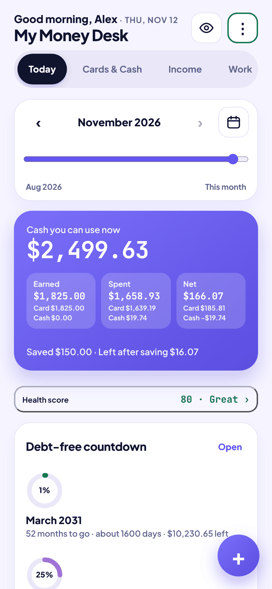

Your day in one screen.

- **Cash you can use now**: the money in your everyday accounts (debit and cash; savings and the overseas account are kept apart).
- **Earned, Spent, Net** for the month, plus how much you moved to savings and what is left after saving.
- **Health score** chip, **Debt-free countdown**, budgets, savings goals and a "safe to spend" estimate, each as its own card that you can switch off or restyle.
- The slider and calendar symbol at the top change the period, so every number on the screen follows the month (or day, or range) you pick.
- The eye hides all amounts. The green, amber or red border on the menu button shows whether your data is saved to the file.

 

### Cards & Cash
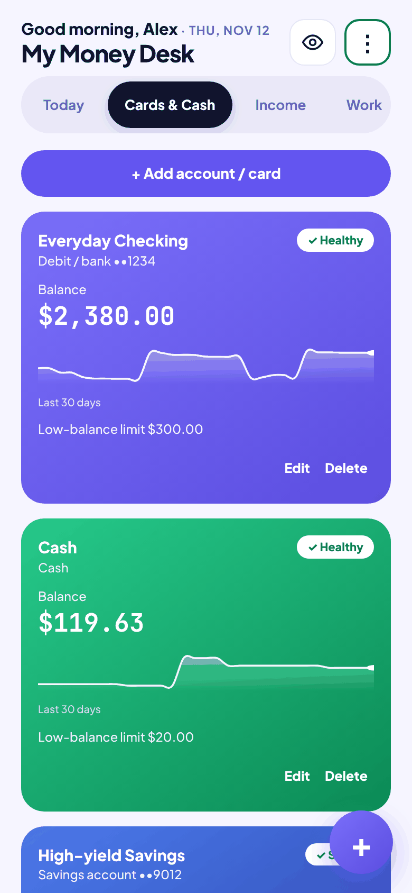

Every account in one place: debit, credit card, cash, savings and a second-currency (₹) account. Each shows a 30-day balance trend and a low-balance warning. Credit cards are linked to a debt, so paying the card lowers the debt and buying on the card raises it.

 

### Income
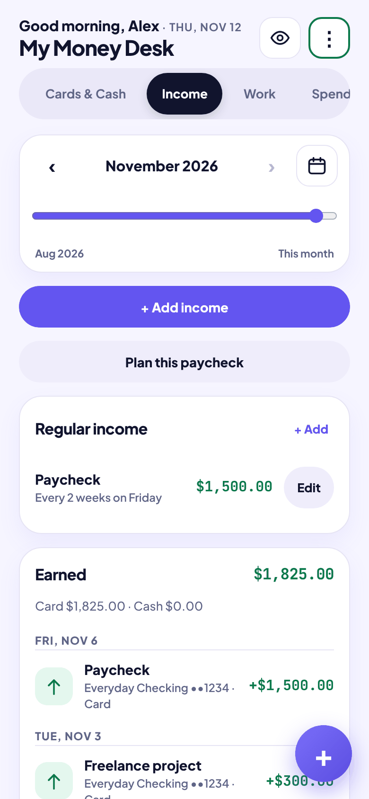

Regular income (like a paycheck every two weeks) is added once. Each expected payment is listed under **Money expected** until you tap **Received** (you can pick the real date if the money came on a different day). **Plan this paycheck** suggests how to split an incoming payment between bills, debts and savings. It only suggests; it never moves money on its own.

 

### Work
Log hours for hourly or cash work at one or more pay rates, see what you are owed, and mark days as paid when the money arrives (which creates the income entry for you). **Hours report (PDF)** makes a printable summary.

### Spend
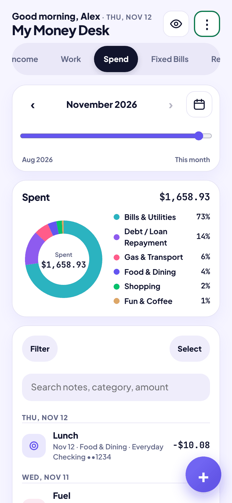

A category breakdown for the period and the full list of entries. Search finds notes, categories, cards and amounts. **Select** turns on bulk edit (change category, tag or account, or delete many entries at once). Tap a category to see the entries behind it.

 

### Fixed Bills
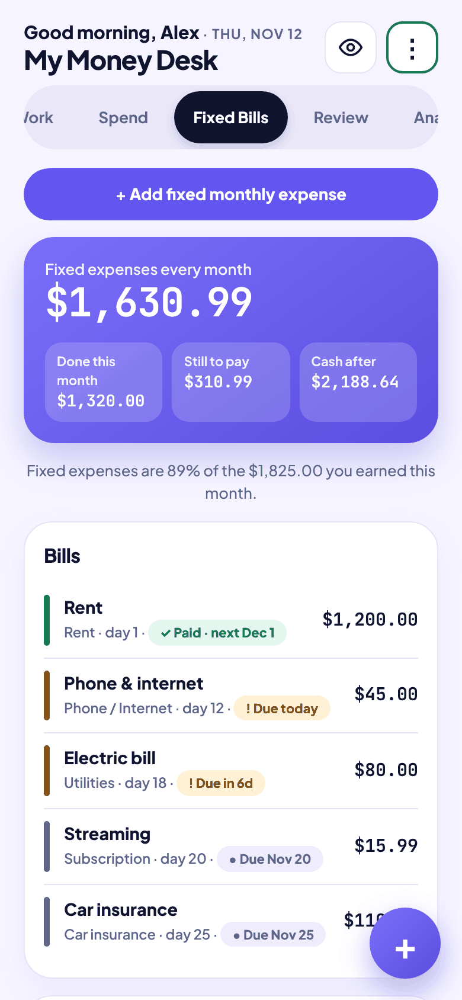

Monthly bills with a status for each: paid, due today, or due in N days. The top card shows how much is done this month, how much is still to pay, and what cash will be left after. **Link an existing payment** marks a bill paid using an expense you already entered, so nothing is counted twice.

 

### Review
A weekly or monthly look back: income kept, comparison with the previous week or month, and where the money went.

### Analytics
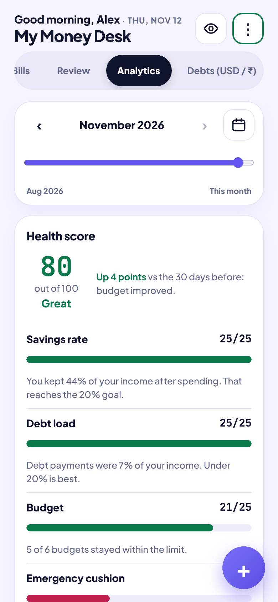

A **health score** out of 100 built from four parts (savings rate, debt load, budget, emergency cushion), each worth up to 25 points. The screen says why the score moved compared with 30 days earlier, so it reads as advice and not just a number.

 

### Debts (USD / ₹)
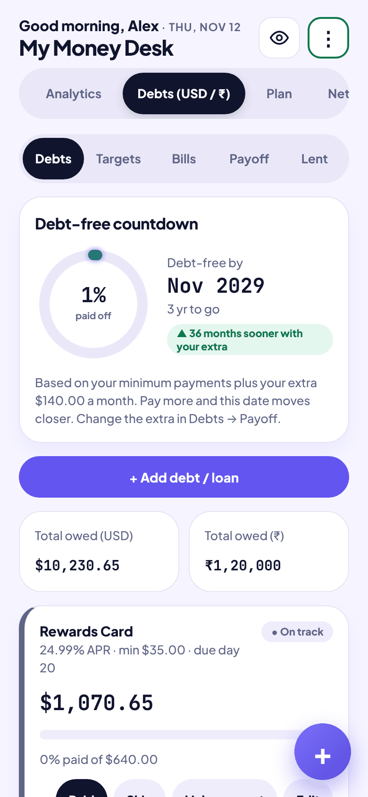

All debts in dollars and rupees, with a **debt-free date** based on your minimum payments plus any extra you plan to pay. Sub-views cover targets (a 0% promo ending, a "must be paid off by" date), bills, **Payoff** planning (avalanche or snowball) and money lent to friends.

 

### Plan
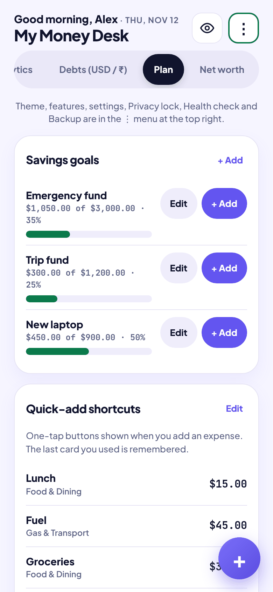

Savings goals with progress and a quick **+ Add**, quick-add shortcuts for the things you buy most, and small money tools such as the emergency-fund calculator.

 

### Net worth (optional)
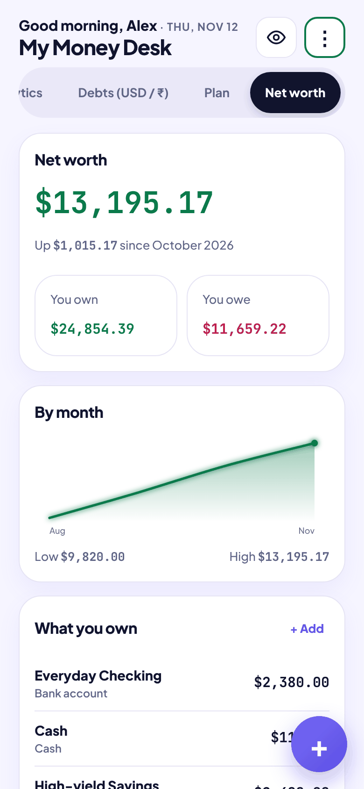

Everything you own minus everything you owe, with a month-by-month line that fills in as the months go by. Add things like a car, a retirement account or a fixed deposit (in dollars or rupees).

 

## The ⋮ menu

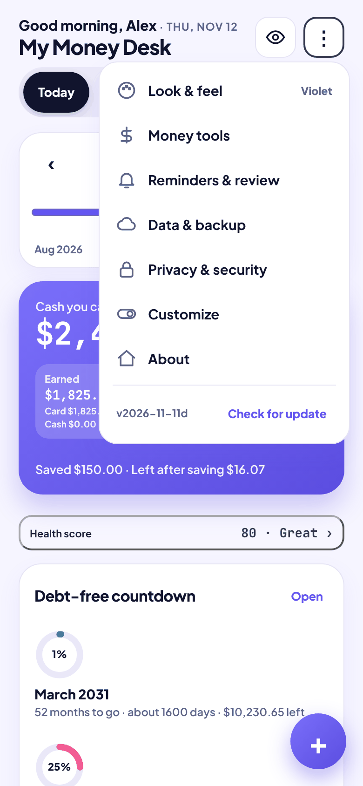

The menu is grouped into pages: **Look & feel**, **Money tools**, **Reminders & review**, **Data & backup**, **Privacy & security**, **Customize** and **About**.

 

### Insights
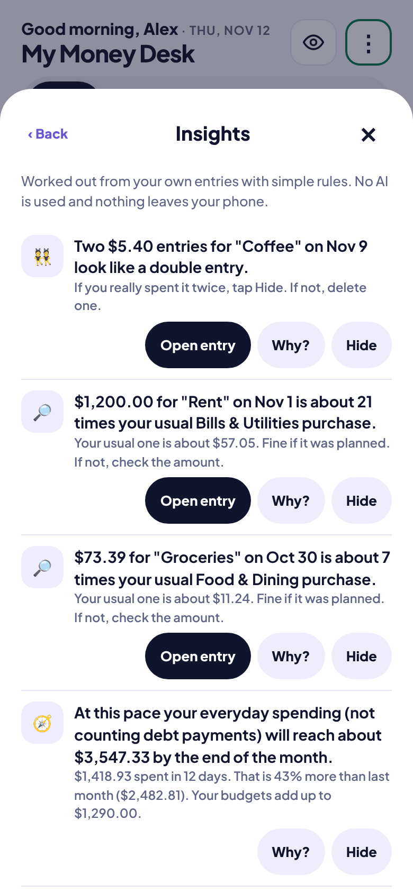

Plain-rule notes worked out from your own entries. No AI is involved and nothing leaves the phone. Each note has **Open entry** (jump to it), **Why?** (the numbers behind it) and **Hide**. Examples on screen: a probable double entry, a purchase far above the usual for its category, and a forecast of where the month will end at the current pace.

 

### Cash flow
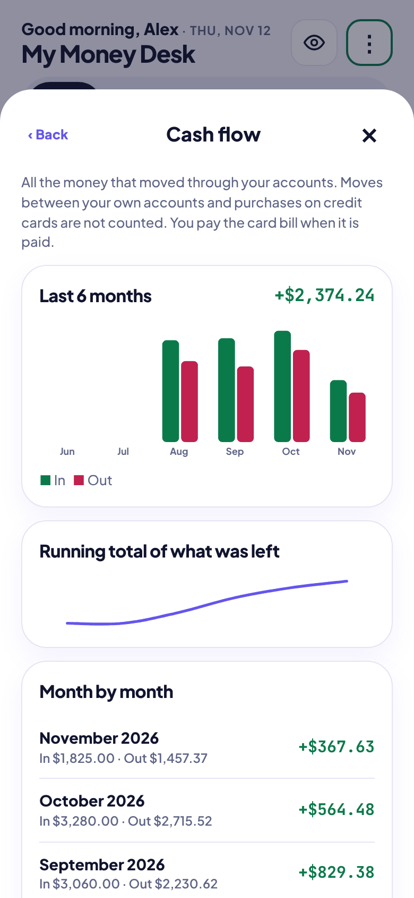

All the money that moved through your accounts, month by month. Moves between your own accounts and purchases on credit cards are not counted again; a card purchase counts when you pay the card bill.

 

### Monthly plan
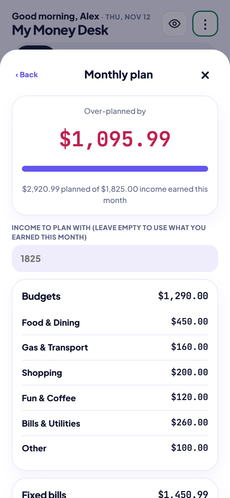

A zero-based plan: give every dollar a job and see what is left to assign.

 

### Health check
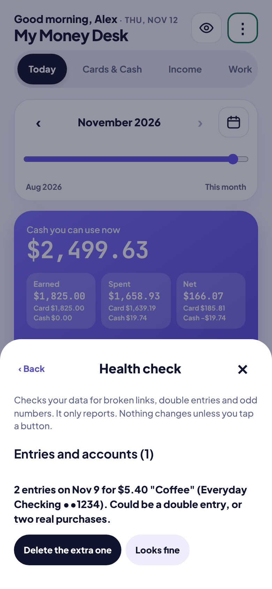

Looks through your data for broken links, probable double entries and numbers that do not add up. It only reports; nothing changes unless you tap the fix button.

 

### Restore points
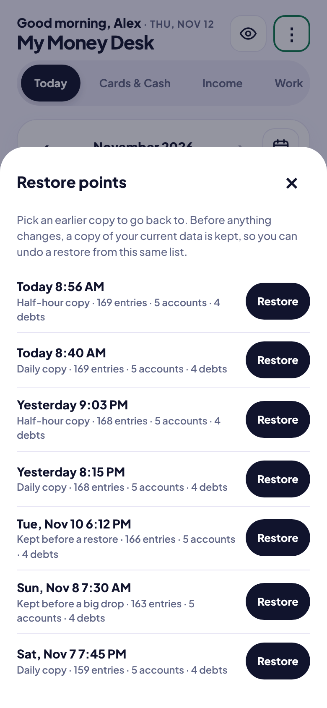

Pick an earlier copy of your data to go back to. Before anything changes, a copy of the current data is kept, so a restore can be undone from the same list. See [how restore points are made](ARCHITECTURE.md#restore-points).

 

### India remittance helper
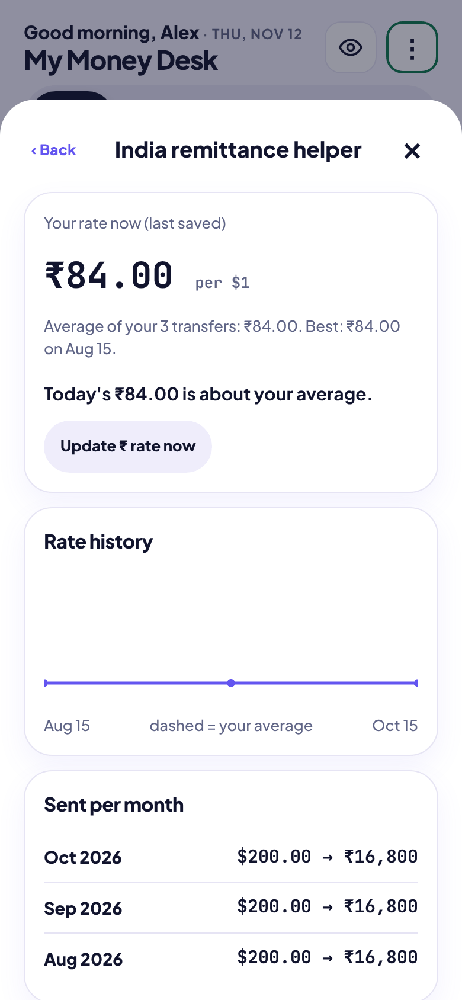

For money sent between two currencies: rate history, today's rate against your average, and totals sent per month.

 

### Add an expense
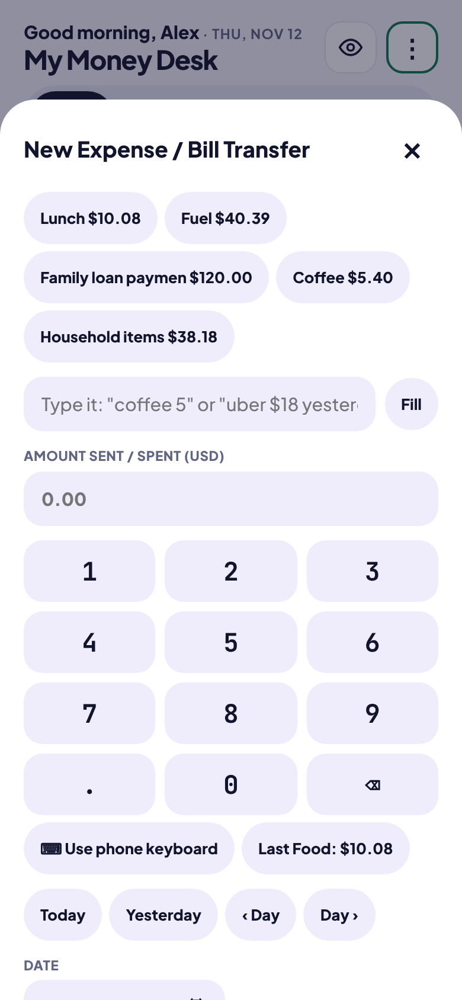

Favorites at the top, a type-it-quickly box (`coffee 5`, `uber 18 yesterday`), a number keypad and date buttons. The fast-add screen can be switched off for a plain form.

 

### Looks
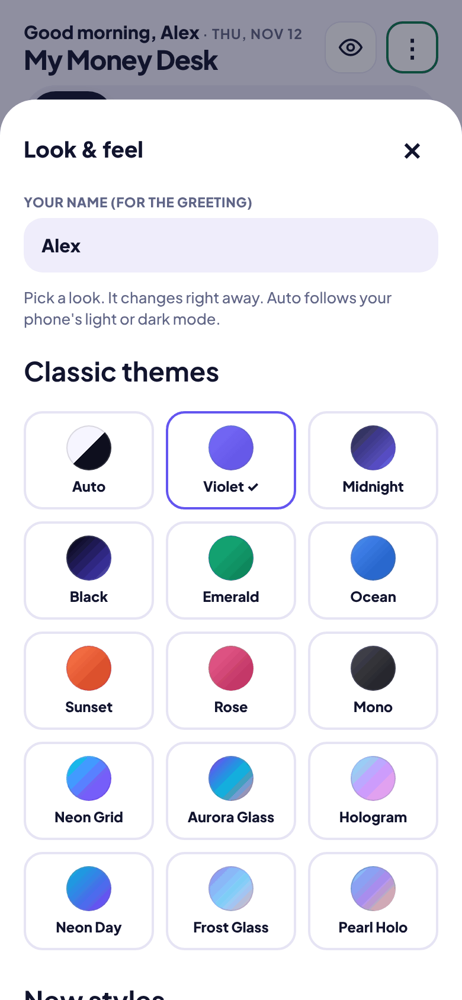

27 looks: 15 classic themes (colors only) and 12 new styles that also change the Today layout and add graphs. Your data is identical in every look.

 

## Every switch

Small features can each be turned on or off in **⋮ > Customize > Features**, and the screens adjust. Turning one off never deletes data; turning it back on brings everything back. There are 56 switches. This table is generated from the app's own `FEATURES` list.

### Today screen

| Switch | What it does | Default |
|---|---|---|
| **Health score** | Score out of 100 on Charts, with a small chip on Today | on |
| **Money plan card** | Safe to spend and the 30-day outlook on Today | on |
| **Savings card** | On Today | on |
| **India card** | On Today | on |
| **Debt targets card** | On Today | on |
| **Budget watch** | On Today | on |
| **Savings goals card** | On Today | on |
| **Debt rings card** | On Today | on |
| **Debt-free date** | A countdown on Today and a celebration when a debt is cleared. | on |
| **Greeting with your name** | Good morning, <your name>, at the top of Today | on |
| **Spending trend graph** | New styles only: 30-day line on Today | on |
| **Budget rings** | New styles only: rings on Today | on |
| **Month heat-map** | New styles only: calendar heat-map on Today | on |
| **Where it went chart** | New styles only: category chart on Today | on |
| **Edit view on cards** | Choose the graph and time range for each Today card, or turn it off. | on |
| **Calendar view** | The calendar symbol opens a month calendar | on |

### Adding and editing entries

| Switch | What it does | Default |
|---|---|---|
| **Fast add screen** | Category buttons, number keypad, date buttons and recent favorites when adding | on |
| **Floating + button** | A round + button instead of the bar at the bottom | on |
| **Type it quickly** | Type "coffee 5" or "uber 18 yesterday" and the form fills itself | on |
| **Tags** | Add #tags to entries and filter by them | on |
| **Split across categories** | Divide one purchase between categories | on |
| **Remember categories** | Picks the category you used last time for the same note | on |
| **Select many entries (bulk edit)** | Change category, tag or account, or delete, for many entries at once. | on |
| **Link an existing payment to a bill** | Mark a bill paid with an expense you already entered. | on |
| **Edit history & restore** | Shows deleted and edited entries so you can bring them back. | on |
| **Import bank statement** | Bring in a CSV file from your bank | on |

### Planning and budgets

| Switch | What it does | Default |
|---|---|---|
| **Monthly plan (zero-based)** | Give every dollar a job and see what is left to assign. | on |
| **Budget rollover** | Carry unused budget to the next month, per category | on |
| **Yearly savings pots** | Set money aside for yearly costs. It is taken off safe to spend | on |
| **Plan this paycheck** | Button on the Income tab | on |
| **Emergency fund calculator** | In Money tools on the Plan tab | on |
| **Repeating expenses** | Subscriptions that appear ready to confirm, plus a subscriptions page | on |
| **Price-rise alert** | Tells you when a bill or subscription costs more than last month. | on |
| **Statement-date reminder** | Pay a card before its statement closes. | on |
| **Two reminder times a day** | A morning and an evening time for reminders. | on |

### Insights and reports

| Switch | What it does | Default |
|---|---|---|
| **Insights** | Smart notes about your spending, bills and cash: on Today and in the ⋮ menu | on |
| **Tap an insight to see why** | Opens the numbers behind each insight. | on |
| **Tap a category to see entries** | Tap a category in Where it went to see its entries. | on |
| **Cash flow view** | Money in, money out and what was left, month by month. | on |
| **Reports & year review** | Trends, custom ranges and a yearly summary | on |
| **Saved filters in Spend** | Filter by category, account or amount and save it. | on |
| **Net worth tab** | A tab with everything you own minus everything you owe, and a monthly chart | off |

### Money tools

| Switch | What it does | Default |
|---|---|---|
| **Split with friends** | Who owes whom, and settle up | on |
| **India remittance helper** | Rate history, today vs your average, totals sent. | on |
| **Reconcile an account** | Type your real bank balance, see the difference and fix it. | on |
| **Cash count** | Count the cash you hold and match the app to it. | on |
| **Credit score log** | Write down your score each month and see the chart. | on |
| **Rewards tracker** | Cashback and points per card, and what you redeemed. | on |
| **Month-end checklist** | A short checklist for the end of each month. | on |
| **Ask AI button** | Copies your summary with a question, in Money tools | on |

### Backup and layout

| Switch | What it does | Default |
|---|---|---|
| **Password-protected backups** | Lets you save a backup file that needs a password to open | on |
| **Switch tabs on or off** | Hide a tab you do not use. Your data and reminders keep working. | on |
| **Grouped ⋮ menu** | Menu items grouped into pages. Off gives the old flat list. | on |

### Android app only

| Switch | What it does | Default |
|---|---|---|
| **Google Drive backup** | Android app only. Keeps a backup copy in your own Google Drive | on |
| **Hide app in recents** | Android app only. Blocks screenshots and hides the app preview when you switch apps | off |
| **Hide amounts on widgets** | Android home-screen widgets show dots instead of money. | off |
